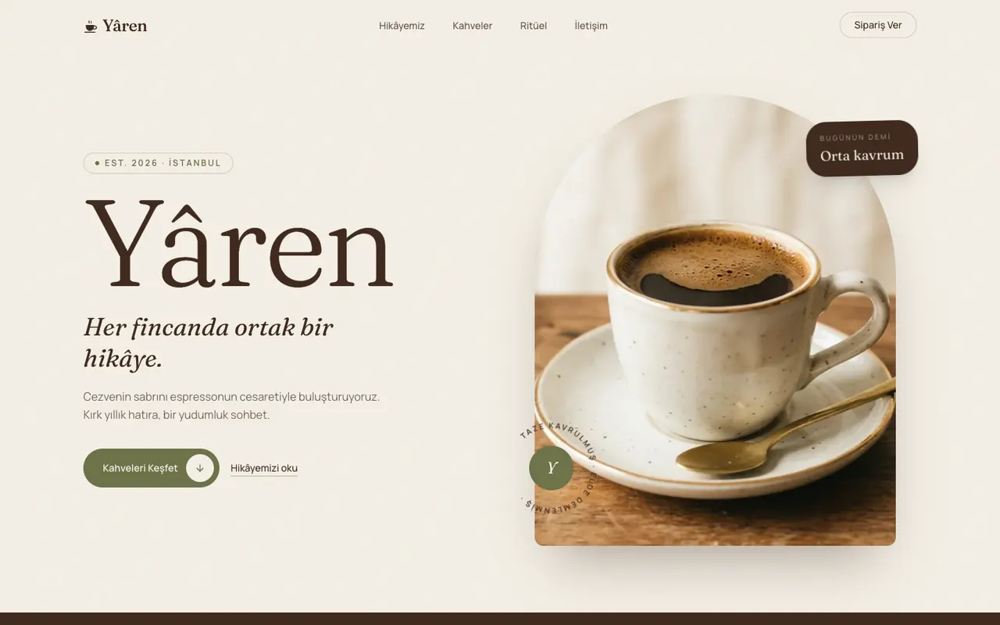
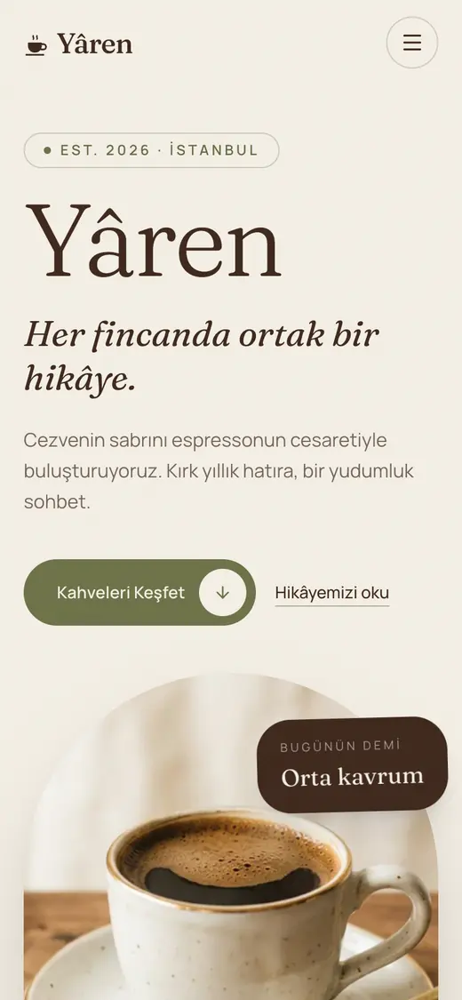

# Yâren

Geleneksel Türk kahvesini espresso ve modern demleme kültürüyle buluşturan hayali bir kahve markası için tek sayfalık site ve yönetim paneli.

**Canlı site:** https://baghouse.com.tr

<p>
    
    
</p>

## Özellikler

- **Tek sayfalık site:** Hikâye, ürünler, zaman çizgisi, telve falı, sıkça sorulan sorular ve iletişim bölümleri.
- **Form doğrulaması:** İstemcide JavaScript, sunucuda Form Request ile çalışır; JavaScript kapalıyken de gönderim yapılır.
- **Yönetim paneli:** Ürünler, site metinleri, SEO alanları ve gelen mesajlar `/yonetim` adresinden yönetilir.
- **Animasyonlar:** GSAP ile kaydırmaya bağlı geçişler; `prefers-reduced-motion` tercihine uyar.
- **SEO:** Panelden yönetilen başlık ve açıklama, JSON-LD yapılandırılmış veri, site haritası ve paylaşım görseli.

## Teknolojiler

Laravel, Blade, Tailwind CSS, Vite, vanilla JS, GSAP, MySQL (canlı), SQLite (yerel).

## Kurulum

Gereksinimler: PHP 8.3+, Composer, Node 22.

```bash
git clone https://github.com/cansukocc/yarencoffee.git
cd yarencoffee
composer install
npm install
cp .env.example .env
php artisan key:generate
```

Panel kullanıcısı için `.env` dosyasındaki `ADMIN_NAME`, `ADMIN_EMAIL` ve `ADMIN_PASSWORD` değerlerini doldurun. Bu değerler boşsa `migrate --seed` adımında kullanıcı oluşturulmaz.

```bash
touch database/database.sqlite
php artisan migrate --seed
npm run build
php artisan serve
```

Site http://127.0.0.1:8000, panel http://127.0.0.1:8000/yonetim adresinde açılır. Yerelde e-postalar gönderilmez, `storage/logs/laravel.log` dosyasına yazılır.

## Test

```bash
php artisan test
```

## Deploy

Sunucuda SSH olmadığı için yayın FTP ile yapılır. `npm run deploy` son commit'i geçici bir klasörde derler, dosya özetlerini sunucudaki manifestle karşılaştırır ve yalnızca değişen dosyaları yükler. `npm run deploy -- --dry-run` sunucuya yazmadan yapılacak değişiklikleri listeler.

## Yaklaşım ve araçlar

Tasarım v0 ile hazırlandı, geliştirme Claude Code ile yapıldı. Next.js çıktısı, FTP ile çalışan paylaşımlı sunucuya uygun ve panel gerektiren bir yapı olduğu için Laravel ve Blade'e taşındı. Case study kapsamına ek olarak içerik yönetimi için yönetim paneli, görünürlük için SEO çalışması eklendi. Görünüm ve metinler tasarıma sadık kalırken form doğrulaması, görsel optimizasyonu ve erişilebilirlik güçlendirildi.
